# Sideline — Software Architecture

| | |
|---|---|
| Scope | The `football-web` Next.js application (production: Vercel `main`, staging: `dev`) |
| Based on | Baseline `main` @ `a4342eb`; updated for local Phase 3–5 code through migration `0031` (Preview verified, not production-deployed) |
| Related | [REQUIREMENTS.md](./REQUIREMENTS.md) · [IMPROVEMENTS.md](./IMPROVEMENTS.md) · [../design/DESIGN_SYSTEM.md](../design/DESIGN_SYSTEM.md) |

---

## 1. Architectural drivers

| Driver | Consequence |
|---|---|
| Tiny group, zero ops budget | Fully managed serverless: Vercel (Hobby) + Neon Postgres + Vercel Blob. No servers, no queues. |
| Mobile, used at the pitch | PWA, server-rendered pages, small client bundles, skeletons on navigation. |
| Real money and real history | Integer money, derived balances, additive migrations, server-side authorisation. |
| Time-based rules (lock, due dates) in Poland, servers in UTC | Absolute instants (`timestamptz`) + Europe/Warsaw conversion in SQL; fail-closed fallbacks. |
| Neon HTTP driver | Each query is one HTTP round trip and there are no interactive transactions → batch/parallelise; protect invariants with unique indexes + retry. |
| Ported from a Streamlit/Python app | Scoring engine is a faithful port, guarded by golden tests against live data. |

## 2. Technology stack

| Layer | Choice |
|---|---|
| Framework | Next.js 16 (App Router, React 19 Server Components, Server Actions) |
| Language | TypeScript |
| Styling | Tailwind CSS v4, design tokens (emerald brand, Outfit + Inter) |
| Auth | Auth.js (NextAuth v5) Credentials provider, JWT sessions |
| Database | Neon serverless Postgres via `@neondatabase/serverless` (HTTP) + Drizzle ORM and raw SQL |
| Validation | Zod |
| Files | Vercel Blob (player photos) |
| Push | Web Push (VAPID, `web-push`) + service worker `sw.js` |
| Drag & drop | `@dnd-kit/core` (draft board) |
| External APIs | OpenStreetMap Nominatim (geocoding), Open-Meteo (weather) |
| Scheduling | Vercel Cron → `/api/cron/reminders` (daily 17:00 UTC) |

## 3. System context (C4 level 1)

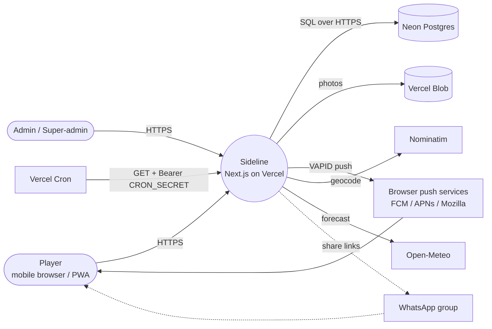

## 4. Deployment view

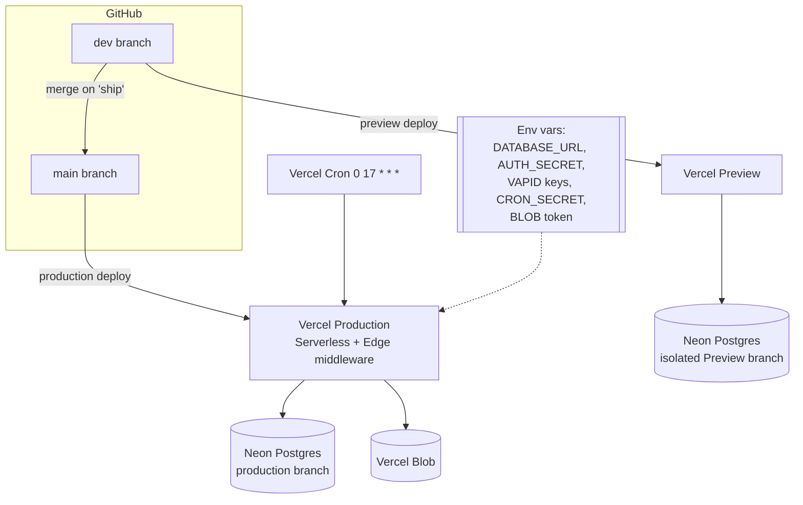

Notes
- Preview uses a separate Neon branch and separate push configuration. Local migration/test
  writes for this batch were guarded against the explicitly approved Preview hostname.
- Migrations are hand-written SQL in `drizzle/00xx_*.sql`, applied manually to Neon before the
  code that needs them is deployed.

## 5. Container / module view (C4 level 2–3)

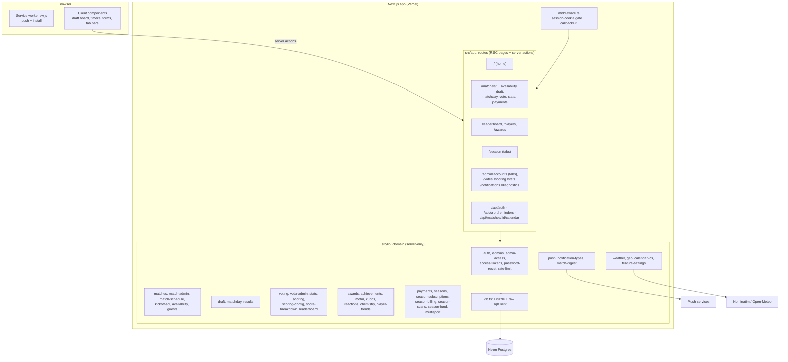

### 5.1 Layering rules

1. **Routes (`src/app`)** compose data and render. Mutations are **Server Actions** in a
   co-located `actions.ts`, which validate input (Zod), **re-check authorisation**, call `src/lib`,
   then `revalidatePath` / `revalidateScores()`.
2. **Domain (`src/lib`)** holds business rules and SQL. Modules marked `server-only` never ship
   to the client. Client-safe helpers are split out (`format-money.ts`, `guests-shared.ts`,
   `*-constants.ts`).
3. **Data (`db.ts`)** exposes Drizzle (typed CRUD) and `sqlClient` (raw parameterised SQL for the
   scoring engine and aggregate queries).

### 5.2 Domain module map

| Bounded area | Modules | Key tables |
|---|---|---|
| Identity & access | `admins`, `admin-access`, `access-tokens`, `password*`, `rate-limit`, `view-mode` | players, player_credentials, admins, admin_sessions, player_access_tokens, password_reset_* |
| Scheduling | `matches`, `match-admin`, `match-schedule`, `kickoff-sql`, `weather`, `geo`, `calendar-ics` | matches |
| Availability | `availability`, `guests` | match_availability, match_guests |
| Teams & play | `draft`, `matchday`, `results` | match_players, match_rounds, round_goals, match_scorekeepers, admin_tab_locks |
| Rating | `voting`, `vote-admin`, `stats`, `scoring`, `scoring-config`, `score-breakdown`, `leaderboard`, `score-snapshots` | votes, vote_skips, vote_audit, stats, player_stats_submissions, player_goals_claims, legacy_* |
| Recognition | `awards`, `achievements`, `motm`, `kudos`, `reactions`, `chemistry`, `player-trends` | award_overrides, player_achievements, match_motm_votes, player_kudos, match_reactions |
| Money | `payments`, `seasons`, `season-subscriptions`, `season-billing`, `season-scans`, `season-fund`, `multisport` | payments, seasons, season_subscriptions, season_invoices, multisport_scans, guest_charges, fund_adjustments |
| Messaging | `push`, `notification-types`, `match-digest` | push_subscriptions, push_preferences |
| Config | `feature-settings` | app_settings |

## 6. Data model

### 6.1 Core entities

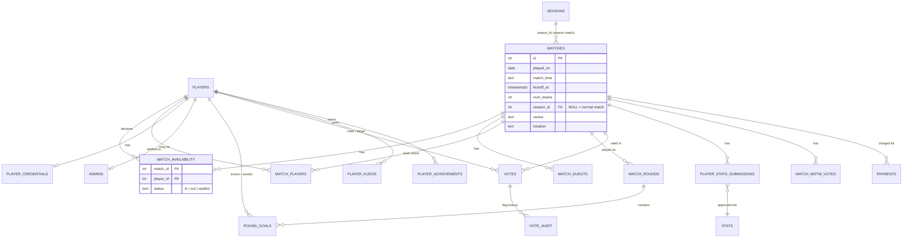

### 6.2 Season and money

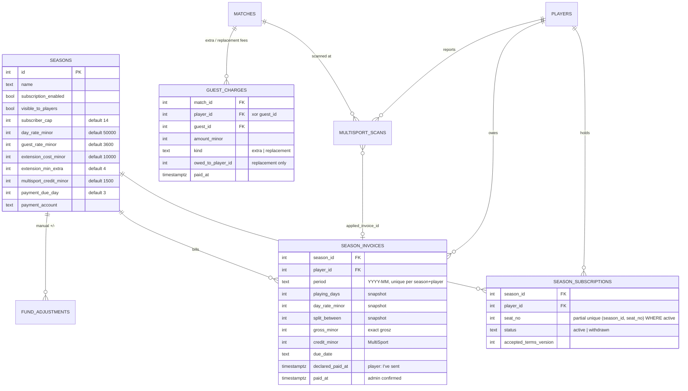

Charged and payable amounts are not stored: `charged = CEIL(gross / 100) × 100`,
`payable = max(charged − credit, 0)`, `rounding surplus = charged − gross`, computed identically in
SQL (`season-billing.ts`) and JS (`format-money.ts`). Status is derived from `declared_paid_at` /
`paid_at`.

**Group fund balance** is a query, not a column:

```
fund = Σ extra-player fees + Σ (charged − gross) rounding surplus
       − Σ session extensions ± Σ fund_adjustments
```

### 6.3 Schema source of truth

`drizzle/00xx_*.sql` (applied in order) is authoritative. `drizzle/schema.ts` only types the
tables from `0000`; newer tables are reached via raw SQL (see IMPROVEMENTS C-1).

## 7. Key runtime flows

### 7.1 Request lifecycle (page + server action)

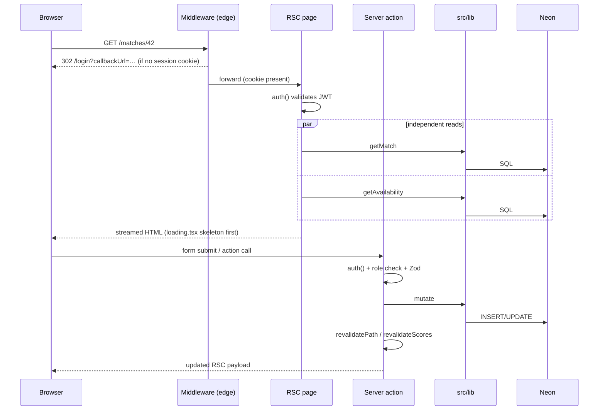

### 7.2 Availability change with 24 h lock

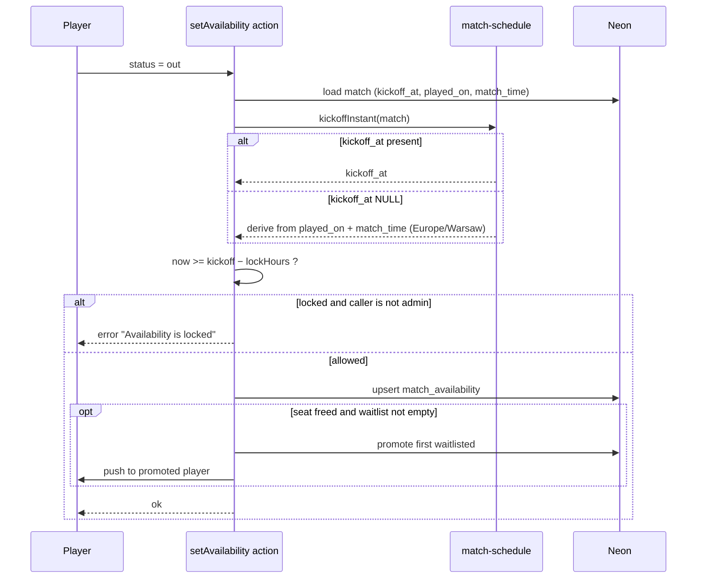

### 7.3 Match creation and season auto-IN

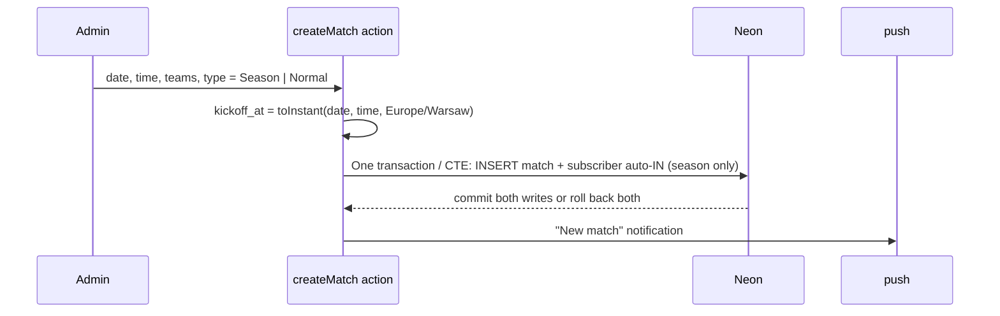

### 7.4 Monthly season invoicing

```mermaid
sequenceDiagram
  participant Ad as Admin
  participant B as season-billing
  participant DB as Neon
  participant Pl as Player

  Ad->>B: generate invoices for YYYY-MM
  B->>DB: count season Sundays in month, active seats, approved unapplied MultiSport scans
  B->>B: gross = day_rate × playing_days / split_between (grosz)
  B->>B: charged = CEIL(gross / 100) × 100, payable = charged − MultiSport credit (credit capped at charged; rest carries over)
  B->>DB: Transaction: lock eligible scans FOR UPDATE, INSERT invoices, allocate locked scans
  DB-->>B: commit invoices + credits together (duplicate invoices do not consume credit)
  Pl->>DB: view invoice, due countdown (SQL, Warsaw end-of-day)
  Pl->>DB: declare "sent"
  Ad->>DB: confirm paid
```

### 7.5 Seat reservation under concurrency

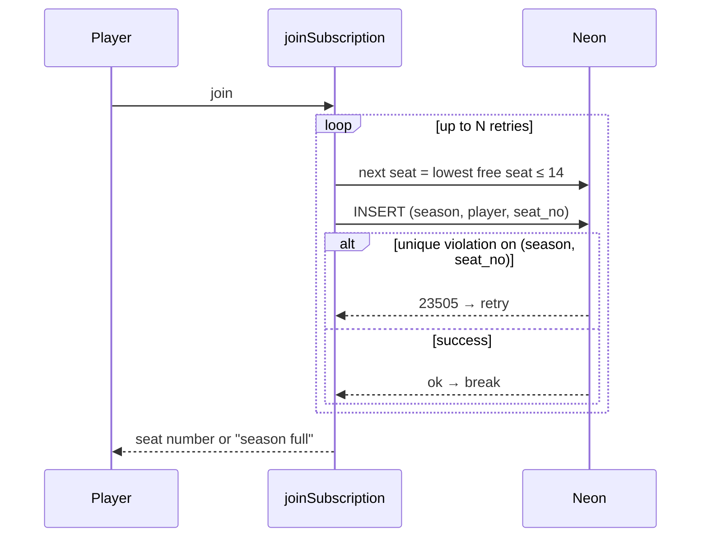

### 7.6 Daily reminders (cron)

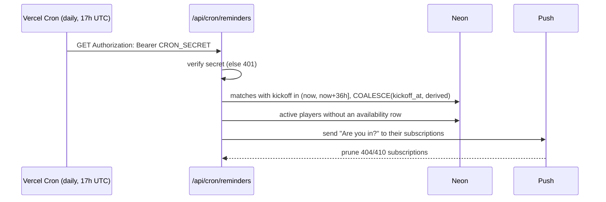

### 7.7 Rating pipeline

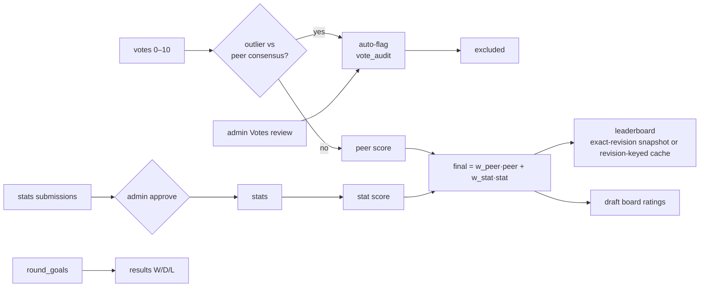

### 7.8 Personal moments and recorded audio

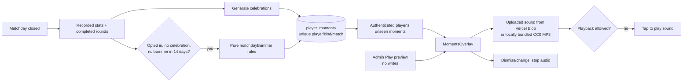

`bummer-rules.ts` is client-safe and DB-free. Zero-contribution checks require known stats,
a completed round and a matchday MID/FWD assignment; preferred positions are not a substitute
because players rotate. Loss-record checks compare mini-match wins and losses, not a season rank.
`moment-copy.ts` contains default copy, admin-editable kind metadata and preview payloads.
All bummer kinds share the opt-out and cooldown.

`silly-sounds.ts` plays the super-admin's uploaded celebration/bummer sounds (Vercel Blob URLs
listed in `app_settings`, passed to the overlay by `MomentsGate`); a group without uploads falls
back to the recorded applause/cheers/laughter in `public/audio/`, whose source pages, CC0 licenses
and SHA-256 checksums are recorded in `public/audio/LICENSES.txt`. Informational moments are
silent. Audio is requested only on playback and is capped at 8 seconds. The separate tap-spam
easter egg reuses a single voice per tap (custom upload or synthesized fart) so rapid taps never
overlap. The overlay traps keyboard
focus, supports Escape and respects reduced-motion preferences for haptics/animations.

### 7.9 Revision-stamped scores and operational safeguards

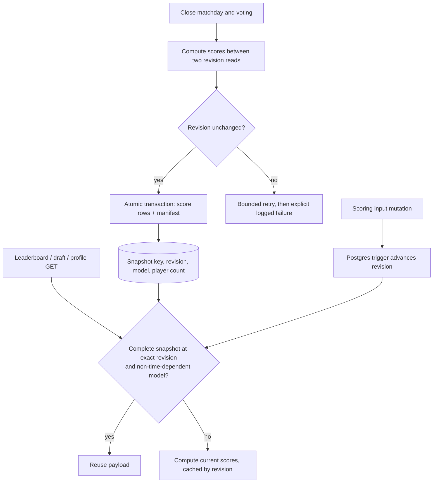

Revision triggers cover `players`, `matches`, `match_players`, `votes`, `stats`,
`player_stats_submissions`, and `scoring_*` settings. A snapshot contains the score payload
needed by hot reads as well as historical rank data. Missing/malformed rows or a changed model
reject reuse. Time-decayed scoring is always computed from current time. Read paths do not write.

The release checklist stores explicit confirmations on the season. Concurrent invoice periods
lock the same MultiSport scan rows before summing/allocating, preventing double-credit use.
Reserve-list updates serialize through an atomic settings-row update.
Payment QR generation lazily imports a local encoder in the browser; validated Polish account,
amount and reference never leave the app for a QR service. Oversized/unsupported fields retain
the complete manual-transfer path rather than truncating details.

Server-action/cron failures can persist a sanitized record in `app_errors`; Diagnostics displays
recent entries. Admin CSV endpoints additionally require an unlocked Diagnostics permission and
use private/no-store responses. These exports omit authentication/push secrets and are not full
backups. Neon recovery/pre-season snapshots require separate operational configuration.

## 8. Cross-cutting concerns

| Concern | Approach |
|---|---|
| Authentication | Auth.js Credentials, JWT session cookie; middleware only checks cookie presence; every page/action calls `auth()`. |
| Authorisation | `admin-access.ts` helpers in each action; super-admin for Admin control; "view as player" is a UI mode, not a privilege drop on the server. |
| Time | `kickoff-sql.ts` / `match-schedule.ts` centralise Europe/Warsaw conversion; fail-closed fallback when `kickoff_at` is NULL. |
| Money | Integer grosz (`*_minor` columns); `format-money.ts` is the only formatter; invoice snapshot columns; derived fund. |
| Caching | `unstable_cache` with tag `scores` for leaderboard/score reads; `revalidateScores()` after score-affecting writes; most other pages `force-dynamic`. |
| Concurrency | Unique/partial indexes + retry; admin tab locks for draft editing. |
| Rate limiting | DB-backed counters (`rate-limit.ts`) so limits hold across serverless instances. |
| Notifications | `notification-types.ts` catalogue + per-player preferences; dead subscriptions pruned. |
| Feature flags | `app_settings` via `feature-settings.ts`; season `visible_to_players`. |
| Testing | Golden tests for scoring and awards against live DB (`npm run test:scoring`, `test:awards`); build + lint as CI gate. |
| Observability | Vercel logs; Diagnostics page for data integrity. No error tracking service. |

## 9. Architecture decisions (ADR summary)

| # | Decision | Why | Trade-off |
|---|---|---|---|
| ADR-1 | Next.js App Router + Server Actions, no separate API | One deployable, typed end to end | Logic tied to Next.js runtime |
| ADR-2 | Neon HTTP driver | Works in serverless/edge without pooling | No interactive transactions; latency per query |
| ADR-3 | Invariants via unique indexes + retry | Replace transactions safely | Retry loops must be written per case |
| ADR-4 | Store `kickoff_at` as `timestamptz` | Avoid UTC vs Warsaw bugs | Needs backfill + fallback for legacy rows |
| ADR-5 | Explicit `matches.season_id` | Season rules only where admin intends | Admin must choose at creation |
| ADR-6 | Derived fund balance | No drift between ledger and balance | Query cost (one aggregate) |
| ADR-7 | Round-based results as single W/D/L source | Fixes wrong 0 % win rates | Old matches without rounds show "no results" |
| ADR-8 | Keep `vote_audit` writes, drop other audits | `recalculateScope` needs auto-flag history | Less admin forensic history |
| ADR-9 | Daily cron only | Vercel Hobby limit | Reminders are coarse (once/day) |
| ADR-10 | Season hidden behind `visible_to_players` | Test in production with real data before release | Admin-only paths must be checked for leaks |
