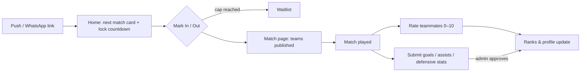
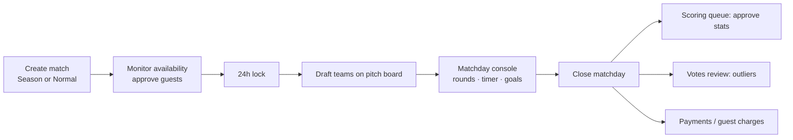
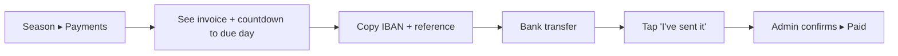
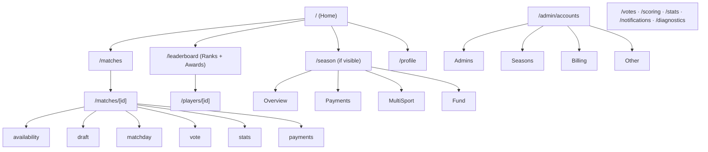

# Sideline — Software Requirements Specification

| | |
|---|---|
| Product | Sideline — weekly football group manager (PWA) |
| Version of this document | Baseline `main` @ `a4342eb`; updated with local Phase 3–5 requirements (Preview verified, not production-deployed) |
| Audience | Group organisers (admins), developers, future contributors |
| Related | [ARCHITECTURE.md](./ARCHITECTURE.md) · [IMPROVEMENTS.md](./IMPROVEMENTS.md) · [scoring-guide.html](./scoring-guide.html) |

---

## 1. Purpose and problem statement

A group of ~20–30 friends plays football every week. Turnout varies (12–18 people, i.e. 2–3
teams of 5–6). The original pain was **unbalanced teams**: a few strong players, many medium
ones and some weaker ones, with no objective way to split them fairly.

Sideline turns each week into a data loop:

```
Availability → Draft balanced teams → Play (live scoring) → Rate peers + submit stats
      ↑                                                                   │
      └───────────── performance-based scores feed the next draft ────────┘
```

Around that core it grew group-logistics features: payments, a paid winter-season
subscription, notifications, weather/location, awards and social features.

## 2. Stakeholders and roles

| Role | Who | Can do |
|---|---|---|
| **Player** | Any registered group member | Set own availability, rate teammates, submit own stats, see ranks/profiles, kudos, MOTM vote, pay/declare payments, join season subscription |
| **Guest** | Non-member brought by a player | Exists only as a named entry on a match; needs admin approval; no login |
| **Admin** | Organisers (assigned per-player) | Everything a player can, plus create/edit matches, manage availability on behalf of others, draft teams, run matchday, approve stats/votes, payments, notifications |
| **Super-admin** | Owner of the group | Admin control: grant/revoke admin, seasons, billing rates, season visibility, fund adjustments, diagnostics |
| **Scorekeeper** | Player delegated by admin for one match | Record goals/assists during that match's matchday console |
| **System (cron)** | Vercel Cron, daily | Availability reminders, lock notifications |

An admin can switch to **"view as player"** to see the app as a player would.

## 3. Scope

**In scope:** a single private group, mobile-first web app installable as PWA, Polish
context (PLN, Europe/Warsaw, MultiSport card).
**Out of scope (today):** multiple clubs/tenants, online card payments, native apps,
public sign-up without admin awareness.

---

## 4. Functional requirements

Priority: **M** = must (core loop), **S** = should, **C** = could/nice. Existing **Done** items
reflect the deployed baseline. **Local / Preview verified** items still need release.

### 4.1 Accounts and access

| ID | Requirement | Pri | Status |
|---|---|---|---|
| FR-AUTH-1 | Players register with name + password; log in with identifier + password. | M | Done |
| FR-AUTH-2 | Admin may issue a magic link / access token for a player who has no password. | S | Done |
| FR-AUTH-3 | Password reset via request → admin-approved token flow. | S | Done |
| FR-AUTH-4 | All pages except `/login`, `/register`, `/reset`, `/magic`, `/share` require a session; logged-out visitors are redirected with a `callbackUrl` back to the page they wanted. | M | Done |
| FR-AUTH-5 | Login attempts are rate limited across serverless instances (DB-backed, not in-memory). | M | Done |
| FR-AUTH-6 | Super-admin can grant/revoke admin rights per player from Admin control. | M | Done |
| FR-AUTH-7 | Admins can toggle "view as player"; navigation, avatar ring and mode pill reflect the active mode. | S | Done |
| FR-AUTH-8 | Players can be soft-deleted (`deleted_at`) without losing historic matches/scores. | M | Done |

### 4.2 Matches

| ID | Requirement | Pri | Status |
|---|---|---|---|
| FR-MAT-1 | Admin creates a match with date, kickoff time, number of teams (2–5), team names, venue (indoor/outdoor), location. | M | Done |
| FR-MAT-2 | At creation the admin explicitly chooses **Season match** or **Normal match**. Season rules apply only to season matches (`matches.season_id`). | M | Done |
| FR-MAT-3 | Kickoff is stored as an absolute instant (`kickoff_at`, timestamptz) computed in Europe/Warsaw; all deadlines derive from it. | M | Done |
| FR-MAT-4 | If `kickoff_at` is missing, the system derives it from `played_on` + `match_time` rather than disabling time rules. | M | Done |
| FR-MAT-5 | Location search (OpenStreetMap Nominatim) with a Google Maps deep link. | S | Done |
| FR-MAT-6 | Weather forecast for outdoor matches (Open-Meteo). | C | Done |
| FR-MAT-7 | Matches are labelled by date (not "Match N"). | S | Done |
| FR-MAT-8 | Add-to-calendar (.ics) per match; share page `/share/match/[id]` viewable without login. | C | Done |

### 4.3 Availability, waitlist, guests and the 24-hour lock

| ID | Requirement | Pri | Status |
|---|---|---|---|
| FR-AV-1 | Each player marks **In / Out** per match. | M | Done |
| FR-AV-2 | When the match cap is reached, further "In" goes to a **waitlist**; a freed seat auto-promotes the next waitlisted player. | M | Done |
| FR-AV-3 | Players can add guests; guests are pending until an admin approves. | S | Done |
| FR-AV-4 | **24h lock:** within 24 h of kickoff a player can no longer change their own availability (in either direction). Admins can still edit on anyone's behalf. | M | Done (fixed for NULL kickoff) |
| FR-AV-5 | The lock is enforced server-side in the action, not only by hiding UI. | M | Done |
| FR-AV-6 | A countdown to the lock is shown on the match and dashboard; a warning appears when the lock is near. | S | Done |
| FR-AV-7 | Global availability defaults (cap, lock hours) are separate from per-match overrides. | S | Done |
| FR-AV-8 | On season matches, active season subscribers are **automatically IN**. | M | Done |

### 4.4 Team draft

| ID | Requirement | Pri | Status |
|---|---|---|---|
| FR-DR-1 | Admin drafts 2–5 teams on a pitch board via drag & drop from the available pool. | M | Done |
| FR-DR-2 | Each player shows their current rating and preferred position (GK/DEF/MID/FWD; not fixed). | M | Done |
| FR-DR-3 | Team strength totals/averages are visible while drafting to judge balance. | M | Done |
| FR-DR-4 | Concurrent admin edits are prevented with an admin tab lock. | S | Done |
| FR-DR-5 | **Auto-balance**: snake draft ranked by final score, with "re-roll" (small deterministic jitter so near-equal players swap sides). | S | Done (position-blind — see IMPROVEMENTS F-1) |

### 4.5 Matchday console

| ID | Requirement | Pri | Status |
|---|---|---|---|
| FR-MD-1 | Admin runs the match as **rounds** (team A vs team B) with a timer. | M | Done |
| FR-MD-2 | Goals and assists are recorded per round; admin can delegate scorekeepers. | M | Done |
| FR-MD-3 | Substitutions / player loans between teams are supported. | S | Done |
| FR-MD-4 | Win/Draw/Loss results are derived from rounds and round goals (single source of truth, `results.ts`). Players without results show "No results yet", never 0 %. | M | Done |
| FR-MD-5 | Closing matchday invalidates cached scores. | M | Done |

### 4.6 Peer voting and outlier detection

| ID | Requirement | Pri | Status |
|---|---|---|---|
| FR-VO-1 | After a match, each participant rates the other players 0–10. | M | Done |
| FR-VO-2 | A player can skip rating someone they did not observe. | S | Done |
| FR-VO-3 | **Abnormal votes are invalid:** a vote far from the peer consensus for that player is auto-flagged and excluded. | M | Done |
| FR-VO-4 | Admin "Votes review" can manually exclude/restore votes; auto-flag vs manual decisions are distinguishable (`vote_audit`). | M | Done |
| FR-VO-5 | Man-of-the-match vote per match. | C | Done |

### 4.7 Stats, scoring, ranks and awards

| ID | Requirement | Pri | Status |
|---|---|---|---|
| FR-ST-1 | Players submit their own goals/assists; defensive contribution for DEF/GK (e.g. clean sheets, saves) is captured. | M | Done |
| FR-ST-2 | Submissions go to the admin **Scoring queue** for approval. | M | Done |
| FR-SC-1 | Final score = weighted blend of peer score and stat score; weights, minimum matches for "ranked" and fairness defaults are configurable. | M | Done |
| FR-SC-2 | The scoring engine is regression-tested with golden tests against live data. | M | Done |
| FR-SC-3 | "How scoring works" explainer and per-player score breakdown. | S | Done |
| FR-RK-1 | Ranks (leaderboard) filterable by position, minimum matches and **season** (season view uses round-based stats). | M | Done |
| FR-AW-1 | Awards and badges/achievements computed from history; admin may override. | C | Done |
| FR-SO-1 | Public player profiles with trends, chemistry (best teammates), results, kudos. | C | Done |
| FR-SO-2 | Match reactions and digest. | C | Done |

### 4.8 Normal-match payments

| ID | Requirement | Pri | Status |
|---|---|---|---|
| FR-PAY-1 | Admin tracks per-match payments per player (paid / unpaid). | S | Done |
| FR-PAY-2 | Guest/session charges per match. | S | Done |

### 4.9 Winter season subscription (draft feature, hidden from players by default)

Based on the group's written rules (season 08/11/2026 – 30/03/2027).

| ID | Requirement | Pri | Status |
|---|---|---|---|
| FR-SE-1 | Super-admin creates seasons (name, start, end). | M | Done |
| FR-SE-2 | Season visibility toggle `visible_to_players` (default **off**); when off, players see no Season menu, dashboard card or `/season` page; admins see a "draft" banner. | M | Done |
| FR-SE-3 | Players vote on the season terms and join a subscription; **14 core seats**, numbered, capped atomically (no overbooking under concurrency). | M | Done |
| FR-SE-4 | Monthly invoices per subscriber: pitch cost (default 500 PLN / Sunday) split across core seats, minus approved MultiSport credits. | M | Done |
| FR-SE-5 | Money is computed in integer grosz; charged amount is rounded **up** to whole PLN; the rounding surplus goes to the group fund. Invoice inputs are snapshotted. | M | Done |
| FR-SE-6 | Payment due on the **3rd** of the month (configurable); countdown, transfer details and a copyable reference `Sideline YYYY-MM Name`. | M | Done |
| FR-SE-7 | Player can declare "I've sent it"; only an admin confirms payment. | M | Done |
| FR-SE-8 | MultiSport: player reports a scan → admin approves → credit (default 15 PLN) applied on the next invoice. | S | Done |
| FR-SE-9 | Non-core (extra) players on a season match pay a flat fee (default 36 PLN) into the group fund. A replacement for an absent subscriber pays that subscriber instead. | M | Done |
| FR-SE-10 | Extending a session by 0.5 h costs a configurable amount (default 100 PLN) paid from the fund; the app warns when fewer than the minimum extras (default 4) are present. | S | Done |
| FR-SE-11 | Group fund balance is **derived** (fees + rounding surplus − extensions ± manual adjustments), never stored. Visible to players. | M | Done |
| FR-SE-12 | All rates (pitch, extra fee, extension, MultiSport credit, due day, min extras) are configurable by admin. | M | Done |
| FR-SE-13 | Withdrawal of a subscriber does not auto-void invoices (admin judgement, rules §7). | S | Done (manual) |

### 4.10 Notifications

| ID | Requirement | Pri | Status |
|---|---|---|---|
| FR-NO-1 | Web Push notifications with per-type preferences per player. | S | Done |
| FR-NO-2 | Admin can broadcast to selected users and see who is subscribed. | S | Done |
| FR-NO-3 | Daily cron (17:00 UTC) nudges players who have not answered availability for matches within the next 36 h. Endpoint authenticated with `CRON_SECRET`. | S | Done |

### 4.11 Admin control

| ID | Requirement | Pri | Status |
|---|---|---|---|
| FR-AD-1 | Tabbed Admin control: **Admins · Seasons · Billing · Other** (mobile bottom bar + Home). | M | Done |
| FR-AD-2 | Diagnostics page for data-integrity checks. | S | Done |
| FR-AD-3 | Feature settings stored in `app_settings`. | M | Done |

### 4.12 Navigation

| ID | Requirement | Pri | Status |
|---|---|---|---|
| FR-NAV-1 | Global bottom bar on mobile: Home · Matches · Ranks (+ Season when visible). | M | Done |
| FR-NAV-2 | Section-level bottom bars (match, season, admin) with a Home item; only the active item is green, Home/Back are grey. | S | Done |
| FR-NAV-3 | Avatar account menu: view-as toggle, admin links, profile, sign out. | M | Done |

### 4.13 Personal moments and sound

| ID | Requirement | Pri | Status |
|---|---|---|---|
| FR-MOM-1 | Show private, once-only achievement and matchday moments, with editable admin copy and an end-to-end Play preview. | S | Done |
| FR-MOM-2 | Celebrations and bummers use locally bundled CC0 recordings, not synthesized crowd voices or TV clips. Preserve device mute, stop playback on dismissal/change, and offer tap-to-play when autoplay is blocked. | S | Local / Preview verified |
| FR-MOM-3 | Offer at most one bummer per player per 14 days, only when opted in and no celebration was generated for that matchday. Never display it on public rankings. | S | Done |
| FR-MOM-4 | A team losing more completed mini-matches than it won may trigger a losing-record bummer, with at least two rounds recorded. | C | Local / Preview verified |
| FR-MOM-5 | Zero goals and zero assists may trigger a bummer for a player assigned MID/FWD on that matchday. Require recorded stats and a played round; do not infer the role from their preferred position or treat missing stats as zero contribution. | C | Local / Preview verified |

### 4.14 Season release, polish and maintainability

| ID | Requirement | Pri | Status |
| --- | --- | --- | --- |
| FR-REL-1 | Require transfer details, confirmed rates, final terms, test-invoice confirmation and reviewed reminder copy before first season release. Changing hidden-season rates/terms invalidates the relevant confirmation. | M | Local / Preview verified |
| FR-REL-2 | Create match + subscriber auto-IN atomically. Create invoices + allocate approved MultiSport credits atomically; concurrent months must not spend one credit twice. Deleting an invoice releases its credits. | M | Local / Preview verified |
| FR-REL-3 | Show withdrawn subscribers with outstanding invoices, rate-change dates, bulk confirmation of declared payments, and an actionable who-owes list. | S | Local / Preview verified |
| FR-REL-4 | Generate a local Polish transfer QR on an unpaid positive invoice. Validate the account checksum, exact amount, recipient and full reference; explain manual fallback when unsupported. | S | Local / Preview verified |
| FR-REL-5 | Send targeted payment reminders three days before and on the due date, excluding declared, paid and zero-balance invoices. Atomically claim each scheduled reminder to avoid duplicate sends. | S | Local / Preview verified |
| FR-REL-6 | Notify confirmed and waitlisted players on the first daily cron after availability locks and before kickoff. Exact-time lock notifications are not guaranteed on Hobby. | S | Local / Preview verified |
| FR-REL-7 | On matchday/voting close, send a digest with available MOTM, scorer and rating highlights plus a recap link. Do not equate aggregate goal totals with mini-match wins. | S | Local / Preview verified |
| FR-REL-8 | Offer consistent match headers, actionable blocked/empty states, first-run guidance, labelled keyboard-accessible rating controls, reduced-motion support and larger touch targets. Ordinary admins can access Messages. | S | Local / Preview verified |
| FR-REL-9 | Reuse persisted score payloads only when complete and at the exact scoring-input revision/model. Mutations invalidate authoritatively; time-dependent scores recompute. No score-capture writes during GETs. | M | Local / Preview verified |
| FR-REL-10 | Provide sanitized persisted server errors and permission-gated, formula-safe CSV exports for matches, scores, invoices and fund ledger. Never export authentication/push credentials. | S | Local / Preview verified |
| FR-REL-11 | Configure and verify Neon recovery/pre-season snapshots independently of CSV exports. | S | Operational setup pending |

---

## 5. Non-functional requirements

| ID | Category | Requirement |
|---|---|---|
| NFR-1 | Usability | Mobile-first; every core action (mark In, rate, submit stats) reachable in ≤ 3 taps from Home. Installable PWA. |
| NFR-2 | Performance | Tab switches render a skeleton immediately (`loading.tsx`); server pages parallelise independent queries (Neon HTTP = one round trip per query). Target: p75 server render < 800 ms. |
| NFR-3 | Correctness — time | All time rules evaluated in Europe/Warsaw against an absolute instant; never server-local time (Vercel runs UTC). Missing data must not silently disable a rule (**fail closed**). |
| NFR-4 | Correctness — money | Integer minor units only; deterministic rounding (CEIL) identical in SQL and JS; snapshotted invoice inputs; derived balances. |
| NFR-5 | Concurrency | No interactive transactions on the Neon HTTP driver → invariants are protected by unique/partial indexes + retry (e.g. seat numbering). |
| NFR-6 | Security | Server actions re-check role on every call; middleware is only a convenience gate. Secrets live in Vercel env vars only. Cron endpoint requires a bearer secret. |
| NFR-7 | Data integrity | Production DB holds real history: migrations are additive/backfilling; no destructive changes without explicit approval. Soft-delete players. |
| NFR-8 | Availability | Serverless (Vercel) + managed Postgres (Neon); no self-hosted infrastructure. Must fit Vercel Hobby limits (1 cron/day). |
| NFR-9 | Maintainability | TypeScript strict; domain logic in `src/lib/*` (server-only), UI in `src/app/*`; golden tests guard scoring/awards. |
| NFR-10 | Privacy | Group-private by default; only `/share/match/[id]` is public. Season feature hidden until released. |
| NFR-11 | Localisation | UI English; currency PLN; dates/time Europe/Warsaw. |

## 6. Key business rules (quick reference)

| Rule | Value (default) | Configurable |
|---|---|---|
| Availability lock | 24 h before kickoff | Yes (global + per match) |
| Reminder window | matches starting within 36 h | Code |
| Teams per match | 2–5 | Per match |
| Vote range | 0–10, outliers auto-excluded | Thresholds in code |
| Season core seats | 14 | Yes |
| Pitch cost | 500 PLN per Sunday | Yes |
| Extra player fee | 36 PLN flat | Yes |
| 0.5 h extension | 100 PLN | Yes |
| Min extras before extension | 4 | Yes |
| MultiSport credit | 15 PLN per approved scan | Yes |
| Payment due day | 3rd of month (end of day, Warsaw) | Yes |
| Invoice rounding | Up to whole PLN, surplus → fund | No |

## 7. User workflows (wireframe-level)

### 7.1 Player — weekly loop



### 7.2 Admin — weekly loop



### 7.3 Season payments (player)



### 7.4 Screen map



## 8. Acceptance criteria for the critical rules

- **24h lock:** given a match with kickoff Sunday 10:00 Warsaw, a player changing their own
  status at Saturday 10:01 Warsaw is rejected by the server action even if the request is sent
  directly; an admin editing the same row succeeds. Holds when `kickoff_at` is NULL.
- **Seat cap:** 20 simultaneous joins on a 14-seat season produce exactly 14 seats numbered
  1–14 with no duplicates.
- **Invoice rounding:** 500 PLN × 4 Sundays / 14 seats = 142.857… PLN → charged 143 PLN;
  surplus 0.142… PLN × 14 is credited to the fund.
- **Outlier votes:** a 1/10 given to a player whose other votes cluster around 7 is
  auto-flagged and excluded from that player's peer score.
- **Season visibility off:** a non-admin requesting `/season` gets no season data.
