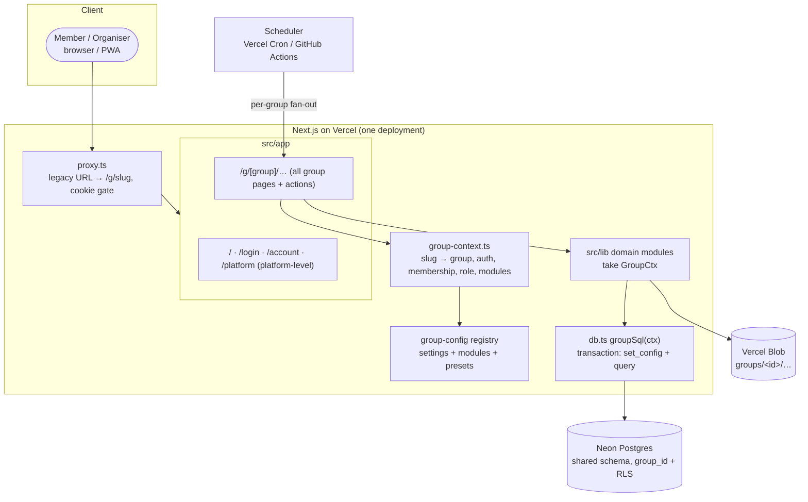
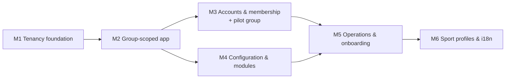

# Sideline Platform — Overview and Decisions

| | |
|---|---|
| Status | Approved; M1 in progress on branch `platform/m1-tenancy-foundation`. No migration has been applied to any deployment database. |
| Release (2026-11-21) | **One production release after M1–M5** are complete and tested on Preview; until then production runs today's code and schema. See [RELEASE.md](./RELEASE.md). |
| Decisions (2026-11-19) | Founding group: **Krakow Pyramids** (`krakow-pyramids`). Example/test group: **Berlin Bears** (`berlin-bears`, Europe/Berlin, EUR), fictional, tests and Preview only. **No charging groups; stay within free tiers** (§6). |
| Baseline | `ai_dev` @ `873736a`, schema through migration `0039` |
| Related | [ARCHITECTURE.md](../ARCHITECTURE.md) · [REQUIREMENTS.md](../REQUIREMENTS.md) · [ROADMAP.md](../../ROADMAP.md) (Longer Term: Multi-Club Support) |

## Milestone documents

| # | Document | What it delivers | Visible to users? |
|---|---|---|---|
| M1 | [01-M1-TENANCY-FOUNDATION.md](./01-M1-TENANCY-FOUNDATION.md) | Every row belongs to a group, and the database enforces it | No |
| M2 | [02-M2-GROUP-SCOPED-APP.md](./02-M2-GROUP-SCOPED-APP.md) | Group-aware routing, scoped queries with RLS, caches, files, push, and cron | URLs gain `/g/<slug>`; old links redirect |
| M3 | [03-M3-ACCOUNTS-AND-MEMBERSHIP.md](./03-M3-ACCOUNTS-AND-MEMBERSHIP.md) | One login per person, memberships in many groups, invitations, **first pilot group** | Yes |
| M4 | [04-M4-GROUP-CONFIGURATION-AND-MODULES.md](./04-M4-GROUP-CONFIGURATION-AND-MODULES.md) | Hardcoded rules become group settings; features become modules; presets | Yes (organisers) |
| M5 | [05-M5-PLATFORM-OPERATIONS-AND-ONBOARDING.md](./05-M5-PLATFORM-OPERATIONS-AND-ONBOARDING.md) | Self-service groups, platform console, hosting upgrade, email, GDPR, quotas | Yes |
| M6 | [06-M6-SPORT-PROFILES-AND-LOCALISATION.md](./06-M6-SPORT-PROFILES-AND-LOCALISATION.md) | Sports other than football, translations (later, optional) | Yes |
| — | [RELEASE.md](./RELEASE.md) | Single production release after M1–M5: migration ledger (expand/contract), rehearsal, release day, rollback | — |

---

## 1. Goal

Today Sideline is one app for one football group in Warsaw. Its rules are written into the
code: Europe/Warsaw time, PLN and Polish bank-transfer QR codes, MultiSport credits, 14-seat
seasons, Sunday billing, and football positions.

The goal is a **platform** that hosts many **groups**. Each group configures its own
logistics: scheduling, signup rules, payments, ratings, and which features it uses. The
current group becomes **group #1 (the founding group)**. It must keep working exactly as it
does today at every step of the migration.

### Terminology

| Term | Meaning |
|---|---|
| Platform | The single deployed Sideline app plus its database, files, and push infrastructure. |
| Group | A tenant: one organised community that plays together. (ROADMAP.md calls it a "club"; same thing.) |
| Account | A person's login identity. Global and shared across groups. *(New in M3.)* |
| Member | An account's participation in one group. This is today's `players` row, scoped to a group. |
| Module | A feature area that a group can switch on or off, e.g. season billing, peer voting, stories. |
| Preset | A named starting configuration (modules + settings) chosen when a group is created. |
| Group app | What a group's members see: platform core + the group's modules + its settings and branding. |

**"Group apps on top of the platform" means configuration, not code.** All groups run the same
codebase and deployment. A group gets its own app through its preset, modules, settings, and
branding. If a group needs behaviour we don't have, it is added as a new option or module that
every group can use. There are no per-group forks, branches, or deployments, because this team
could not maintain them.

## 2. Where we are today (facts that shape the plan)

| Fact | Consequence for the plan |
|---|---|
| 58 tables, 39 SQL functions/triggers, migrations hand-written in `drizzle/` | Tenancy is a schema migration first (M1), done as additive expand/contract steps. |
| ~600 raw-SQL call sites across 57 files via `sqlClient`; Drizzle query builder used in only ~2 files + `auth.ts` | Isolation can't depend on reviewing every query → Postgres **RLS** as the safety net (M2). The single `sqlClient` export in `db.ts` is the choke point where the wrapper goes. |
| `players` is the identity, the membership, *and* the football profile. Login uses the numeric `players.id`; `players.name` is globally `UNIQUE`. ~45 FKs point at `players.id`. | Keep `players` as the **member** row and add `group_id`. Add a separate `accounts` table for identity (M3). Every existing FK stays valid. |
| Global singletons: `app_settings(key PK)`, `score_cache_state(id = 1)`, `admins.username UNIQUE`, `award_overrides(award_type, scope_key)` | These become per-group in M1. |
| `Europe/Warsaw` hardcoded in 10 TS files and in SQL functions from `0016`, `0023`, `0028`, `0037`, `0039` | Timezone moves to `groups.timezone`. M1 adds the column; M4 replaces the hardcoded values. |
| Much of the season config is already data (`seasons.subscriber_cap`, `day_rate_minor`, `guest_rate_minor`, `payment_due_day`, …), and some flags already live in `app_settings` | M4 is smaller than it looks. Much of the work is moving defaults into presets and moving settings to group scope. |
| Invoices and settlements snapshot their inputs | Keep this rule: config changes affect only future records. |
| 167 `revalidatePath` calls, ~159 hardcoded absolute links | Route migration needs path helpers and redirects (M2). |
| Vercel Hobby, one daily cron (17:00 UTC), Neon serverless over HTTP (no interactive transactions), Vercel Blob, Web Push. No email provider. | See §6 Hosting and capacity. |
| `middleware.ts` uses a deprecated Next.js 16 convention (now `proxy.ts`, Node runtime) | Rename it as the first M2 slice, before adding routing logic. |

## 3. Key decisions

### P1. One shared database, one shared schema, a `group_id` column

| Option | Verdict |
|---|---|
| **Shared schema + `group_id`** | **Chosen.** One Neon project, one migration run, one copy of the 39 functions/triggers. Preview branching keeps working. Accounts can span groups. Fits the free tiers and a team of this size. |
| Schema per group (`search_path`) | Rejected. Every migration and trigger runs N times. The HTTP driver has no session to hold `search_path`. Accounts can't easily span groups. |
| Neon project/DB per group | Rejected for now. Strongest isolation, but migrations, connection strings, and cron fan out per group, and operations grow with every group. Reconsider only for a large paying customer that asks for it. |

### P2. Isolation is enforced by the database, not by code review

Three layers, all required:

1. **Composite foreign keys.** Child rows carry `group_id` and reference `(group_id, id)` on
   their parent. The database then rejects a group-B player marked "in" for a group-A match.
2. **Row-level security, fail-closed.** Each request runs its queries in a non-interactive Neon
   transaction that starts with `set_config('sideline.group_id', …, true)`. Policies compare
   `group_id` to that setting. If the setting is missing, queries return no rows instead of
   every group's rows. The app connects as a non-owner role so RLS applies.
3. **Explicit `group_id` filters** in queries, for index use and readability.

Layer 2 matters because the code has ~600 raw-SQL call sites. With RLS, a missing `WHERE
group_id` returns no data instead of leaking another group's data. The mechanism is proven in a
spike in M1 and switched on in M2.

### P3. Keep `players` as the member row; add `accounts` for identity

Changing ~45 FKs and the scoring engine is not realistic. So `players` keeps its id and gains
`group_id` and `account_id`. Credentials, devices, and email move to `accounts` (M3).

### P4. Path-based group URLs: `/g/<slug>/…`

| Option | Verdict |
|---|---|
| **`/g/<slug>/matches/42`** | **Chosen.** Works on Vercel Hobby, keeps one cookie domain and one PWA scope, and makes links shared in WhatsApp and push notifications unambiguous. |
| `<slug>.sideline.app` subdomains | Later, optional. Needs a custom domain with wildcard DNS, and cookies and PWA install are per subdomain. It can be added on top of path routing with a proxy rewrite. |
| Active group stored only in session/cookie | Rejected. Shared links and notifications would open in the wrong group. |

### P5. Configuration, modules, and presets instead of custom code

See M4. Each setting is declared once in a typed registry: schema, default, scope, module, and
who may edit it. Group #1's current behaviour is captured as the `sideline-classic` preset, and
the golden scoring and awards tests guard it.

### P6. Football first, other sports later

The scoring engine is a faithful port guarded by golden tests. Positions are a CHECK constraint
on GK/DEF/MID/FWD. Supporting other sports is M6, after the platform has real groups. M1–M5 do
not block it.

### P7. Stay serverless; add services only when a threshold forces it

No new servers, queues, or container hosting, and no paid plans. Additions are a free-tier
email provider (M5) and a free GitHub Actions scheduler (M5).

## 4. Target architecture

## 5. Sequencing and gates

| Gate | Condition to pass |
|---|---|
| After M1 | ✅ Dev/Preview database migrated; unit gate green; no user-visible change. Golden tests run during the release rehearsal ([RELEASE.md §3](./RELEASE.md#3-rehearsal-before-release-day)). |
| After M2 | RLS enabled on every group table on Preview. The fictional Berlin Bears group in Preview passes the cross-group isolation suite. |
| After M3 (**pilot**) | Multi-membership proven end to end with the fictional Berlin Bears group on Preview. No real second group is waiting; a real one goes live in production only when one asks, invite-only and created by the platform admin. |
| After M4 | Group #1 runs entirely on the `sideline-classic` preset with no hardcoded rules left. A second preset is in use by the pilot. |
| After M5 | Invited groups can onboard themselves within free-tier quotas (tested on Preview). Group export and deletion work. |
| **Release** | Rehearsal on a production copy passes (golden tests, isolation suite, smoke test); then the single production release per [RELEASE.md](./RELEASE.md). |

M3 and M4 can overlap once M2 is done. Do M3 first if a pilot group is waiting; do M4 first if
the pilot needs a different timezone or currency.

### Rough effort (one developer, part-time, AI-assisted, at the recent pace)

| Milestone | Relative size | Rough elapsed time |
|---|---|---|
| M1 | M | 2–3 weeks |
| M2 | **L** (largest: 57 files, routes, links, RLS) | 4–6 weeks |
| M3 | M | 3–4 weeks |
| M4 | L | 4–6 weeks |
| M5 | M | 3–5 weeks |
| M6 | L, optional | later |

These are planning estimates, not commitments. Re-estimate at the end of each milestone.

## 6. Hosting and capacity (free tier only)

**Constraint (decided 2026-11-19):** the platform charges no group and runs entirely on free
tiers: Vercel Hobby, Neon Free, Vercel Blob within Hobby limits, and free email and scheduler
options. Hobby is for non-commercial use, and a free, non-charging platform stays within that.
Free-tier limits therefore cap how many groups and how much activity the platform can host.
The plan enforces that with quotas instead of upgrading.

| Area | Today | Pressure from multi-group | Free-tier plan |
|---|---|---|---|
| **Vercel Hobby** | Free | Function invocations, duration, and bandwidth are shared by all groups | Stay on Hobby. Keep pages server-rendered and small, as today. Per-group quotas (M5) keep one group from using up the shared allowance. |
| **Cron** | One daily job at 17:00 UTC (Hobby limit) | Groups in different timezones need reminders at their own local times | M2: the daily cron fans out to every group. M5: an hourly **GitHub Actions `schedule`** workflow (free) calls `/api/cron/tick` with `CRON_SECRET`; the Vercel daily cron stays as a backstop. |
| **Function duration** | One group per cron run | The fan-out grows with the number of groups | Process groups in batches with a time budget, keep a per-group cursor, and make runs idempotent (notification leases already exist). |
| **Neon Free** | One project, Preview branch | Storage and compute grow roughly linearly with groups. Per-request RLS adds a statement but no extra round trip. | One shared database (P1) is the only model that fits one free project. Check storage and compute usage in the Neon console monthly, and add a Diagnostics read-out. Add indexes that lead with `group_id`, and rely on autosuspend. |
| **Vercel Blob** | Player photos, stories, sounds | Files from many groups | Store under `groups/<id>/…`, compress uploads client-side, enforce per-group quotas, and prune orphaned files in cron (M5). |
| **Email** | None. Password reset is admin-mediated, and magic links are shared manually. | Invites and password resets for people outside the group | Keep admin-generated invite links (no email needed). Add email in M5 only on a provider's free tier, behind `src/lib/email.ts`. |
| **Push** | One VAPID key pair | None. One key pair serves all groups. | Subscriptions move to accounts (M3), and payloads carry the group slug. |

**Capacity rule:** when a free-tier metric passes ~70 % of its limit, stop admitting new groups
(the M5 waitlist) instead of upgrading. Check the current limits in each provider's dashboard;
they change over time, so this document doesn't repeat them.

## 7. How we work within current capacity

- **Every slice is testable on Preview.** Each milestone is a series of small commits on a
  platform branch that you push to `ai_dev` for Preview. Production receives nothing until the
  single release ([RELEASE.md](./RELEASE.md)), so slices may change behaviour on Preview, but
  each one keeps the unit gate green.
- **Migrations use expand → backfill → contract**, as separate reviewed SQL files, each tagged
  in the [RELEASE.md](./RELEASE.md) ledger. They are applied to the dev/Preview database as they
  land; production gets them all on release day (expand before the deploy, contract after).
  With only one group, backfill means `group_id = 1`.
- **Tests come first for isolation.** PGlite tests (already used for `0037`–`0039`) seed two
  groups and assert that nothing crosses between them. The golden tests guard group #1.
- **Update [ARCHITECTURE.md](../ARCHITECTURE.md)** at the end of each milestone, not up front.

## 8. Top risks

| Risk | Mitigation |
|---|---|
| A query leaks data across groups | RLS fail-closed, composite FKs, two-group isolation suite, a CI grep check for unscoped `sqlClient` use |
| `DEFAULT 1` on `group_id` silently files new rows under group #1 | Remove the defaults in M2, once every insert passes `group_id` explicitly. A test asserts that no group table has a default left. |
| The route move breaks old WhatsApp links, push links, and installed PWAs | Proxy redirects legacy paths to the member's group. Keep these redirects permanently. |
| The Warsaw time conversion in SQL triggers changes billing or kickoff results | Change the timezone source only in M4. Keep the value `Europe/Warsaw` for group #1 and compare results in tests. |
| The scope grows to "every sport, every payment method" | Football first (P6). Modules ship off by default. Presets cover common setups. |
| Free-tier limits reached as groups grow | Quotas per group, monthly usage checks, waitlist new groups at ~70 % of a limit (§6) |
| One developer becomes the bottleneck | Small PRs, a written plan per milestone, and one milestone active at a time (except M3/M4 overlap) |

## 9. Explicitly out of scope

- Per-group code forks, plugins that run custom code, or separate deployments.
- Charging groups, and any paid hosting plan.
- Taking payments on behalf of groups. Players keep paying organisers directly. The platform
  only tracks dues, which avoids payment-regulation obligations.
- Native mobile apps. The PWA stays.
- Database-per-tenant (revisit only on a specific customer requirement).
